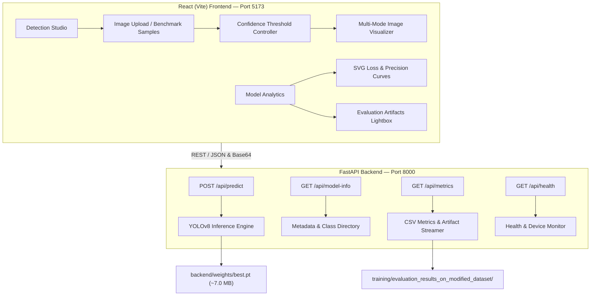

# 🔧 ToolVision AI — Hand Tool Detection & Instance Segmentation

> **An enterprise-grade computer vision web application for automated detection, localization, and sub-pixel polygon instance segmentation across 18 industrial hand tool classes using YOLOv8, FastAPI, and React.**

---

## 📌 Overview

ToolVision AI is an end-to-end Computer Vision platform engineered to detect, classify, and isolate hand tools in workshop, construction, and manufacturing environments. The system couples a fine-tuned **YOLOv8n-seg** deep learning model with an asynchronous **FastAPI** backend and a responsive, high-precision **React 19** interface.

---

## ✨ Key Features

- **🎯 Sub-Pixel Instance Segmentation**: Generates boundary contour polygon masks alongside bounding box coordinates and confidence scores.
- **🛠️ 18 Industrial Tool Classes**: Recognizes _Hammer, Screwdriver, Wrench, Pliers, Cutting pliers, Needle-nose pliers, Gas wrench, Adjustable spanner, Handsaw, Backsaw, Drill, Calipers, Ratchet, Tape measure, Utility knife, Gun, Hand, and search-for-tools_.
- **🖼️ Interactive Detection Studio**:
  - Drag-and-drop image upload with real-time preview and file validation (JPEG, PNG, WebP up to 10MB).
  - One-click benchmark test samples (Hammer, Wrench, Pliers, Screwdriver) for zero-setup evaluation.
  - Granular confidence threshold tuning (0.05 to 0.95) with recall/precision presets.
  - Multi-mode visualizer: Segmentation Overlay, Original Photography, and Synchronized Side-by-Side view.
  - Detection details cards with match percentage, bounding box coordinates, and one-click coordinate clipboard export.
  - Full-resolution annotated image export.
- **📊 Model Analytics Dashboard**:
  - Key performance indicators: **80.0% mAP@50**, **72.1% mAP@50-95**, 15 training epochs, and 18 tool categories.
  - Interactive SVG loss convergence curves (Bounding Box & Segmentation loss) and Mean Average Precision trajectories.
  - Full-resolution evaluation artifact gallery with modal inspection (Normalized/Raw Confusion Matrices, PR curves, F1 curves, and Validation predictions).
  - Searchable 18-class tool directory grouped by industrial category.
- **⚡ Production-Ready Architecture**:
  - Standalone FastAPI REST API with CORS middleware, lifespan model preloading, and automatic GPU/CPU device resolution.
  - Automated test suite with 100% endpoint pass rate using `pytest` and `httpx`.
  - Clean light-theme design system built with the Inter typography and responsive flex/grid layouts.

---

## 🏗️ System Architecture



---

## 🚀 Getting Started

### 📋 Prerequisites

- **Python**: 3.10+ (tested on Python 3.11)
- **Node.js**: 18+ and npm

---

### 💻 Installation & Environment Setup

#### 1. 🐍 Backend Setup

The backend utilizes an isolated Python virtual environment inside `backend/`:

```powershell
# Navigate to backend directory
cd c:\Projects\ToolPrediction\backend

# Create virtual environment
python -m venv venv

# Activate virtual environment
# Windows PowerShell:
.\venv\Scripts\Activate.ps1

# Install required packages
pip install -r requirements.txt
```

#### 2. ⚛️ Frontend Setup

In a separate terminal:

```powershell
# Navigate to frontend directory
cd c:\Projects\ToolPrediction\frontend

# Install dependencies
npm install
```

---

## 🖥️ Running the Application

### 1. 🚀 Start the FastAPI Backend

From the project root:

```powershell
cd c:\Projects\ToolPrediction
$env:PYTHONPATH="."
.\backend\venv\Scripts\python.exe -m uvicorn backend.main:app --host 127.0.0.1 --port 8000 --reload
```

- **Backend Base URL**: `http://127.0.0.1:8000`
- **Interactive Swagger Documentation**: `http://127.0.0.1:8000/docs`
- **ReDoc Documentation**: `http://127.0.0.1:8000/redoc`
- **Health Check**: `http://127.0.0.1:8000/api/health`

### 2. ⚡ Start the React Frontend

From the `frontend/` directory:

```powershell
cd c:\Projects\ToolPrediction\frontend
npm run dev
```

- **Web Application**: `http://127.0.0.1:5173`

_(Note: The frontend dev server is configured with an automatic proxy forwarding `/api/_`, `/docs`, and `/openapi.json`directly to`http://127.0.0.1:8000`)\*.

---

## 📡 REST API Reference

| Method | Endpoint                        | Description                                   | Request / Query                                                    | Response                                 |
| ------ | ------------------------------- | --------------------------------------------- | ------------------------------------------------------------------ | ---------------------------------------- |
| `GET`  | `/api/health`                   | Health and model readiness status             | None                                                               | `HealthResponse`                         |
| `GET`  | `/api/model-info`               | Model metadata, device, and class taxonomy    | None                                                               | `ModelInfoResponse`                      |
| `GET`  | `/api/metrics`                  | Epoch training metrics and available plots    | None                                                               | `MetricsResponse`                        |
| `GET`  | `/api/metrics/image/{filename}` | Streams evaluation plots or validation images | Path parameter: `filename`                                         | Image binary (`image/png`, `image/jpeg`) |
| `POST` | `/api/predict`                  | Runs YOLOv8 instance segmentation on an image | `file`: UploadFile (Multipart)<br>`confidence`: float (0.01 - 1.0) | `PredictionResponse`                     |

### 📝 Sample Inference Payload:

```json
{
  "detections": [
    {
      "class_id": 8,
      "class_name": "Hammer",
      "confidence": 0.9421,
      "bbox": { "x1": 218.4, "y1": 112.5, "x2": 425.8, "y2": 435.0 },
      "mask": { "points": [[220, 115], [420, 115], [425, 185], "..."] }
    }
  ],
  "total_detections": 1,
  "image_width": 640,
  "image_height": 480,
  "inference_time_ms": 38.45,
  "annotated_image": "data:image/jpeg;base64,..."
}
```

---

## 🧪 Automated Testing & QA

An automated test suite covering all validation rules, image endpoints, and error handling is included in [`backend/tests/test_api.py`](file:///c:/Projects/ToolPrediction/backend/tests/test_api.py).

```powershell
cd c:\Projects\ToolPrediction
$env:PYTHONPATH="."
.\backend\venv\Scripts\python.exe -m pytest backend/tests -v
```

### ✅ Test Results:

```
backend/tests/test_api.py::test_root_endpoint PASSED              [ 11%]
backend/tests/test_api.py::test_health_endpoint PASSED            [ 22%]
backend/tests/test_api.py::test_model_info_endpoint PASSED        [ 33%]
backend/tests/test_api.py::test_metrics_endpoint PASSED           [ 44%]
backend/tests/test_api.py::test_metric_image_found PASSED         [ 55%]
backend/tests/test_api.py::test_metric_image_not_found PASSED     [ 66%]
backend/tests/test_api.py::test_predict_invalid_extension PASSED  [ 77%]
backend/tests/test_api.py::test_predict_empty_file PASSED         [ 88%]
backend/tests/test_api.py::test_predict_valid_image PASSED        [100%]

======================== 9 passed in 5.80s =========================
```

---

## 📊 Model Specifications & Training Summary

| Metric / Parameter     | Value                                             |
| ---------------------- | ------------------------------------------------- |
| **Model Architecture** | YOLOv8n-seg (Nano Instance Segmentation)          |
| **Model Weights File** | `backend/weights/best.pt` (7,030,900 bytes)       |
| **Input Shape**        | 640 × 640 pixels                                  |
| **Dataset Source**     | Roboflow Hand Tool Modified Dataset               |
| **Training Duration**  | 15 Epochs                                         |
| **Best Box mAP@50**    | **80.0%** (0.7996)                                |
| **Best Box mAP@50-95** | **72.1%** (0.7209)                                |
| **Best Mask mAP@50**   | **70.9%** (0.7092)                                |
| **Inference Hardware** | CUDA GPU acceleration with automatic CPU fallback |

### 🧰 Tool Class Directory:

```json
[
  "search-for-tools",
  "Adjustable spanner",
  "Backsaw",
  "Calipers",
  "Cutting pliers",
  "Drill",
  "Gas wrench",
  "Gun",
  "Hammer",
  "Hand",
  "Handsaw",
  "Needle-nose pliers",
  "Pliers",
  "Ratchet",
  "Screwdriver",
  "Tape measure",
  "Utility knife",
  "Wrench"
]
```

---

## 📁 Repository Directory Layout

```
c:\Projects\ToolPrediction\
├── .gitignore                                # Git ignore rules
├── README.md                                 # Project documentation
│
├── backend/                                  # FastAPI Backend
│   ├── main.py                               # Application entry point & CORS
│   ├── config.py                             # Paths, upload limits, and parameters
│   ├── requirements.txt                      # Backend dependencies
│   ├── weights/
│   │   └── best.pt                           # YOLOv8 instance segmentation weights
│   ├── models/
│   │   ├── __init__.py
│   │   └── schemas.py                        # Pydantic request & response models
│   ├── routers/
│   │   ├── __init__.py
│   │   ├── predict.py                        # /api/predict router
│   │   ├── metrics.py                        # /api/metrics & artifact router
│   │   └── model_info.py                     # /api/model-info & /api/health router
│   ├── services/
│   │   ├── __init__.py
│   │   ├── inference.py                      # YOLOv8 singleton & mask processor
│   │   └── metrics_parser.py                 # results.csv & artifact parser
│   ├── tests/
│   │   ├── __init__.py
│   │   └── test_api.py                       # Automated test suite (9 test cases)
│   ├── uploads/                              # Temporary upload storage
│   │   └── .gitkeep
│   └── venv/                                 # Dedicated Python virtual environment
│
├── frontend/                                 # React (Vite) Frontend
│   ├── index.html                            # HTML entry point with Inter font
│   ├── vite.config.js                        # Vite proxy configuration
│   ├── package.json                          # Frontend dependencies
│   ├── src/
│   │   ├── main.jsx                          # React application root
│   │   ├── App.jsx                           # Main layout & navigation
│   │   ├── index.css                         # Light-theme design system tokens
│   │   ├── utils/
│   │   │   └── api.js                        # REST API client
│   │   ├── components/
│   │   │   ├── Navbar.jsx                    # Executive navigation header
│   │   │   ├── ImageUploader.jsx             # Drag-and-drop & sample generator
│   │   │   ├── PredictionView.jsx            # Multi-mode visualizer
│   │   │   └── DetectionCard.jsx             # Detection information card
│   │   └── pages/
│   │       ├── PredictPage.jsx               # Detection Studio page
│   │       └── DashboardPage.jsx             # Analytics & Taxonomy page
│   └── dist/                                 # Optimized production build
│
└── training/                                 # Research & Training Artifacts
    ├── CV_Project_Roboflow_Train.ipynb       # Colab training & evaluation notebook
    └── evaluation_results_on_modified_dataset/ # Evaluation runs, curves & plots
        └── runs/segment/train-modified/
            ├── results.csv
            ├── confusion_matrix_normalized.png
            ├── BoxPR_curve.png / MaskPR_curve.png
            └── val_batch*.jpg
```

---

## 🛠️ Built With

- **[Ultralytics YOLOv8](https://docs.ultralytics.com/)**: Real-time instance segmentation neural network.
- **[FastAPI](https://fastapi.tiangolo.com/)**: High-performance asynchronous Python web API.
- **[PyTorch](https://pytorch.org/)**: Deep learning tensor computation and model runtime.
- **[React 19](https://react.dev/)**: Reactive user interface library.
- **[Vite](https://vite.dev/)**: Next-generation frontend build tooling.
- **[Lucide React](https://lucide.dev/)**: Clean, consistent vector iconography.
- **[Pillow](https://python-pillow.org/)**: Image manipulation and format encoding.
- **[Pytest](https://pytest.org/)**: Automated testing framework.
