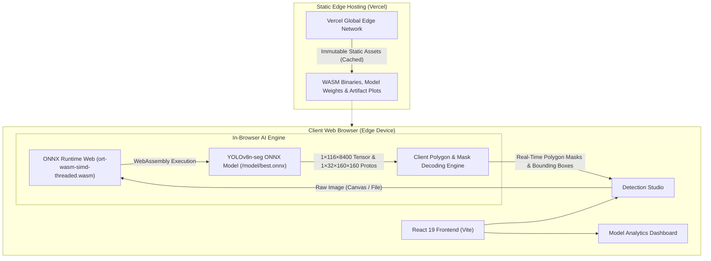

# 🌟 ToolVision AI — Hand Tool Detection & Instance Segmentation

> **An enterprise-grade, 100% serverless computer vision web application for real-time detection, localization, and sub-pixel polygon instance segmentation across 18 industrial hand tool classes using YOLOv8n-seg, WebAssembly, and ONNX Runtime Web.**

---

## ✨ Features

- **⚡ 100% Client-Side In-Browser Inference**: Executes deep learning inference entirely on the client's device using ONNX Runtime Web (WASM SIMD multithreaded). Zero server cold starts, no backend latency, and complete privacy (images never leave the user's browser).
- **🎯 Sub-Pixel Instance Segmentation**: Produces pixel-accurate contour polygon masks along with bounding box coordinates and classification confidence scores for 18 industrial hand tool classes.
- **🛠️ 18 Industrial Hand Tool Classes**: Accurately recognizes *Hammer, Screwdriver, Wrench, Pliers, Cutting pliers, Needle-nose pliers, Gas wrench, Adjustable spanner, Handsaw, Backsaw, Drill, Calipers, Ratchet, Tape measure, Utility knife, Gun, Hand, and search-for-tools*.
- **🖼️ Interactive Detection Studio**:
  - Drag-and-drop image upload with real-time preview (JPEG, PNG, WebP up to 10MB).
  - One-click benchmark sample photos (*Hammer, Wrench, Pliers, Screwdriver*) for zero-setup evaluation.
  - Granular confidence threshold tuning (0.05 to 0.95) with instant re-detection.
  - Multi-mode visualizer: *Segmentation Overlay*, *Original Photography*, and *Synchronized Side-by-Side* view.
  - Interactive detection detail cards with match percentage, bounding box coordinates, and one-click coordinate clipboard export.
  - Full-resolution annotated image canvas download.
- **📊 Instant Model Analytics & Benchmarks**:
  - Key performance indicators: **80.0% mAP@50**, **72.1% mAP@50-95**, 15 training epochs, and 18 tool categories loaded synchronously in 0ms.
  - Interactive SVG loss convergence curves (Bounding Box & Segmentation loss) and Mean Average Precision trajectories.
  - Zero-lag full-resolution evaluation artifact gallery with modal inspection (*Normalized & Raw Confusion Matrices, PR curves, F1 curves, and Validation batch predictions*).
  - Searchable 18-class tool directory grouped by industrial function.
- **☁️ Zero-Backend Serverless Deployment**: Optimized for instant static hosting on Vercel with immutable asset caching and zero infrastructure cost.

---

## 🏗️ System Architecture



---

## 🚀 Getting Started

### Prerequisites

- **Node.js**: `v18.0.0` or higher (tested on Node.js v20+)
- **Package Manager**: `npm` (v9+)

---

### Installation

1. **Clone the repository:**
   ```bash
   git clone https://github.com/DhrumilKhatiwala/ToolVision.git
   ```

2. **Navigate to the frontend directory:**
   ```bash
   cd ToolVision/frontend
   ```

3. **Install dependencies:**
   ```bash
   npm install
   ```

---

## 💻 Usage

### Development Server

Start the local Vite development server:
```bash
npm run dev
```

Open your browser and navigate to:
```
http://127.0.0.1:5173
```

### Production Build

Compile and bundle the production-ready static application:
```bash
npm run build
```

Preview the production build locally:
```bash
npm run preview
```

### Deploy to Vercel

ToolVision AI is 100% serverless and deploys to Vercel with zero backend configuration:
```bash
npx vercel
```
Or push to GitHub with Vercel Git integration connected.

---

## 📊 Model Specifications & Training Summary

| Metric / Parameter | Value |
| :--- | :--- |
| **Model Architecture** | YOLOv8n-seg (Nano Instance Segmentation) |
| **Quantized Model File** | `frontend/public/model/best.onnx` (13.8 MB) |
| **Training Checkpoint** | `training/weights/best.pt` (7.0 MB) |
| **Input Resolution** | 640 × 640 pixels |
| **Dataset Source** | Roboflow Industrial Hand Tool Modified Dataset |
| **Training Duration** | 15 Epochs |
| **Best Box mAP@50** | **80.0%** (0.7996) |
| **Best Box mAP@50-95** | **72.1%** (0.7209) |
| **Best Mask mAP@50** | **70.9%** (0.7092) |
| **Inference Hardware** | WebAssembly SIMD Multithreaded (Client In-Browser) |
| **Inference Latency** | ~100 ms – 300 ms (Zero Cloud Network Overhead) |

### 🧰 Hand Tool Class Taxonomy (18 Classes)

```json
[
  "search-for-tools",
  "Adjustable spanner",
  "Backsaw",
  "Calipers",
  "Cutting pliers",
  "Drill",
  "Gas wrench",
  "Gun",
  "Hammer",
  "Hand",
  "Handsaw",
  "Needle-nose pliers",
  "Pliers",
  "Ratchet",
  "Screwdriver",
  "Tape measure",
  "Utility knife",
  "Wrench"
]
```

---

## 📁 Repository Directory Layout

```
ToolPrediction/
├── README.md                                 # Standardized project documentation
├── vercel.json                               # Vercel root build configuration & caching
├── .gitignore                                # Git ignore configuration
│
├── frontend/                                 # 100% Serverless React Application
│   ├── index.html                            # HTML entry point with Inter typography
│   ├── vite.config.js                        # Vite build configuration
│   ├── package.json                          # NPM dependencies
│   ├── vercel.json                           # Vercel immutable asset caching headers
│   │
│   ├── public/                               # Static distribution assets
│   │   ├── model/
│   │   │   └── best.onnx                     # YOLOv8n-seg ONNX model (13.8 MB)
│   │   ├── onnx-wasm/                        # WebAssembly SIMD ONNX runtime binaries
│   │   ├── samples/                          # Benchmark sample evaluation photos
│   │   ├── eval_results/                     # High-resolution validation plots
│   │   ├── metrics.json                      # Epoch training metrics
│   │   └── model-info.json                   # Model metadata & class taxonomy
│   │
│   └── src/
│       ├── main.jsx                          # React application entry
│       ├── App.jsx                           # Main layout & navigation
│       ├── index.css                         # Light-theme design system tokens
│       ├── data/
│       │   └── staticData.js                 # Bundled synchronous metrics for 0ms load
│       ├── utils/
│       │   ├── api.js                        # API & static asset helper
│       │   └── onnxInference.js              # In-browser ONNX inference & mask decoder
│       ├── components/
│       │   ├── Navbar.jsx                    # Executive navigation header
│       │   ├── ImageUploader.jsx             # Drag-and-drop & sample generator
│       │   ├── PredictionView.jsx            # Multi-mode visualizer (Canvas & Overlay)
│       │   └── DetectionCard.jsx             # Detailed detection card
│       └── pages/
│           ├── PredictPage.jsx               # Detection Studio page
│           └── DashboardPage.jsx             # Model Analytics & Taxonomy page
│
└── training/                                 # Research & Training Artifacts
    ├── CV_Project_Roboflow_Train.ipynb       # Colab training & evaluation notebook
    ├── weights/
    │   └── best.pt                           # PyTorch original training checkpoint
    └── evaluation_results_on_modified_dataset/ # Training run charts & metrics
```

---

## 🛠️ Built With

- [React 19](https://react.dev/) - Reactive user interface framework
- [Vite](https://vite.dev/) - Next-generation frontend build tooling
- [ONNX Runtime Web](https://onnxruntime.ai/) - High-performance WebAssembly machine learning runtime
- [Ultralytics YOLOv8](https://docs.ultralytics.com/) - Real-time instance segmentation neural network architecture
- [Lucide React](https://lucide.dev/) - Enterprise-grade clean vector iconography
- [Vercel](https://vercel.com/) - Zero-config serverless edge hosting

---

## 🤝 Contributing

Contributions, issues, and feature requests are welcome! 
Feel free to check out the [issues page](https://github.com/DhrumilKhatiwala/ToolVision/issues).

---

## 📝 License

This project is licensed under the MIT License - see the [LICENSE](LICENSE) file for details.
